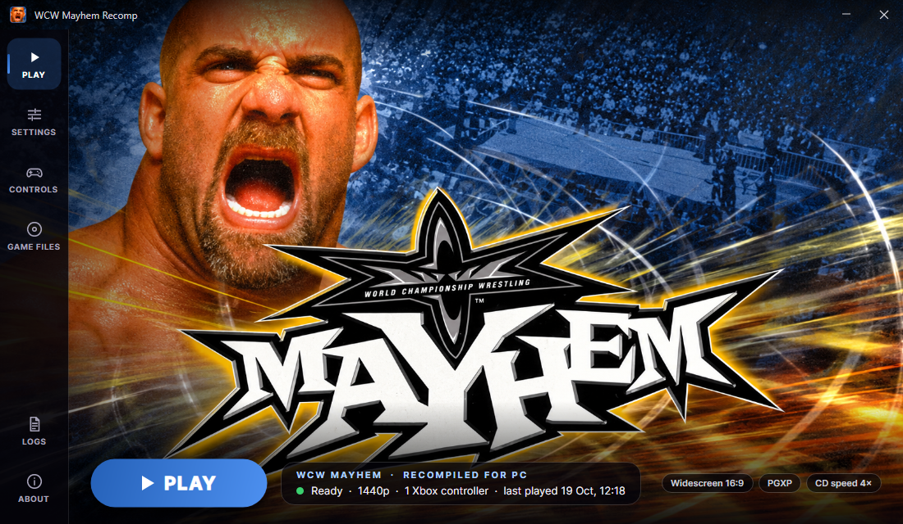
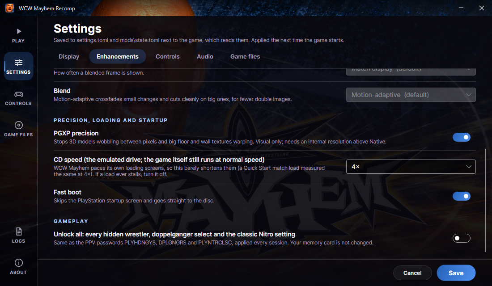

# WCW Mayhem Recompiled

An unofficial PC version of **WCW Mayhem** (PlayStation, 1999), made by statically recompiling
the PlayStation game to native code with [psxrecomp](https://github.com/mstan/psxrecomp). It
does **not** include the game: you need your own disc image of the PAL release.



## Play

1. Download the latest zip from [Releases](https://github.com/dotGrx/WCW-Mayhem-RECOMP/releases)
   and extract all of it to a normal folder, for example `C:\Games\WCW Mayhem` (not Program
   Files: the game writes its settings and memory cards next to itself).
2. Start `WCWMayhemLauncher.exe`.
3. Under **GAME FILES**, choose your disc image (`.cue`, with its `.bin` beside it). The launcher
   checks that it is the version this port is built from.
4. Press **PLAY**.

You need:

- Windows 10 or 11, 64-bit
- A graphics card with OpenGL 3.3 and a current driver
- Your own **WCW Mayhem** for PlayStation, **PAL (Europe), SLES-02193**, as a `.cue` / `.bin`
  disc image (Redump: `WCW Mayhem (Europe).cue`, track 1 MD5
  `f05d7e5edad41f89e3c679dad83ea5f2`). The launcher tells you if yours differs.
- A controller is recommended. Xbox controllers work out of the box; the keyboard works too.

No PlayStation BIOS is needed: the game runs on the bundled, open-source OpenBIOS.

## What the PC version adds

| | |
| --- | --- |
| **Native code** | The game's MIPS code is translated to C and compiled for x64; nothing is emulated on the CPU side. |
| **16:9 widescreen** | A genuinely wider view of the arena, not a stretch. Ring posts, turnbuckles, steps and barriers in the extra width are drawn too (the game's own on-screen test is widened). Menus and videos keep their 4:3 framing. 21:9 and fit-to-window are there too, untested. |
| **Higher resolution** | Native to 8K internal resolution; 1440p by default. |
| **No polygon wobble** | PGXP keeps 3D models at their exact positions instead of snapping them to whole pixels, and corrects texture warping. On by default. |
| **Xbox controllers** | Pads are picked up automatically and shared out to players in order; digital or DualShock mode, deadzone, and a Controls page in the launcher. Players 3 and 4 use the emulated multitap. |
| **Unlock all** | Every hidden wrestler, doppelganger select and the classic Nitro setting, using the game's own Pay-Per-View passwords every session. Your memory card is not changed ([before / after](docs/unlock_all_before_after.png)). |
| **Smooth motion** | Optional frame blending up to your display's refresh rate. The game itself still runs at its original 25 fps (PAL), so this crossfades frames rather than adding new ones. |
| **Launcher** | Home screen, settings, controls, disc check, logs. |

All of these are in the launcher. Display and controller options are saved in `settings.toml`
next to `WCWMayhem_Recompiled.exe`; the enhancements are mod packages, switched in
`mods\state.toml`:

| Feature | File / key |
| --- | --- |
| Internal resolution | `settings.toml` `[video] internal_resolution` (`native`, `720p`, `1080p`, `1440p`, `4k`, `5k`, `8k`, `display`) |
| Fullscreen, vsync, renderer, filtering, CRT filter | `settings.toml` `[video]` |
| Controllers | `settings.toml` `[controller] p1_device`..`p4_device` (`gamepad` / `keyboard` / `none`), `p1_mode`.. (`digital` / `analog`), `p1_deadzone`.. |
| Widescreen | mod `wcw.enhancement.widescreen` (on by default), option `aspect` = `16:9` / `21:9` / `fit` |
| PGXP | mod `psx.enhancement.pgxp` (on by default) |
| Unlock all | mod `wcw.cheat.unlock-all` |
| Smooth motion | mod `wcw.enhancement.smooth-motion`, options `rate`, `blend` |
| CD speed | mod `psx.enhancement.cd-speed` (WCW Mayhem paces its own loading screens, so this barely helps) |



## Building from source

You need Windows 10/11 x64 and:

- Git
- Python 3.9 or later
- .NET 10 SDK (for the launcher)
- Your own WCW Mayhem (Europe) disc image (MD5 above)

CMake, Ninja and the clang/llvm-mingw compiler come from psxrecomp's portable toolchain pack,
which the build downloads once into `%USERPROFILE%\.local\share\retcomm\toolchains` (psxrecomp
also adds it to your user PATH). Set `PSXRECOMP_TOOLCHAIN_DIR` to an unpacked pack to use that
instead.

```bat
git clone https://github.com/dotGrx/WCW-Mayhem-RECOMP.git
cd WCW-Mayhem-RECOMP
powershell -ExecutionPolicy Bypass -File scripts\setup-psxrecomp.ps1
build.cmd "D:\Games\WCW Mayhem (Europe).cue"
launcher\build.cmd
```

`setup-psxrecomp.ps1` clones psxrecomp at the commit this port is built on into `psxrecomp\`
and applies this project's patches to it (see [patches/README.md](patches/README.md)).

`build.cmd` builds `build-release\WCWMayhem_Recompiled.exe`. The first build copies your disc
image into `disc\`, checks it, extracts its boot executable (`SLES_021.93`) and recompiles it into
`generated\` (all three are git-ignored)
(`psxrecomp_cli.py generate`, driven by `game.toml`); later builds need no disc argument. Pass
`-Regenerate` after changing `game.toml`'s `[widescreen]` sites, the seeds or the patches.
`launcher\build.cmd` builds `launcher\dist\WCWMayhemLauncher.exe`, which finds the game in
`build-release\`.

To make the release zip:

```bat
powershell -ExecutionPolicy Bypass -File scripts\package.ps1
```

It stages the game, the files it reads beside itself (bundled OpenBIOS, mod catalog,
`game.toml`), the launcher, `README.txt` and the licences under `out\release\` and zips them. It
refuses to package if any disc data, generated code, memory card or player setting would end up
in the zip.

### Repository layout

| Path | |
| --- | --- |
| `game.toml` | The port's configuration: disc identity, recompiler seeds, video defaults, PGXP settings, widescreen cull sites |
| `src\mods\wcw_mods.c` | The PC side of the port: widescreen, smooth motion and unlock-all plugins |
| `mods\preloaded\` | The mod packages the launcher switches (and the default-on PGXP override) |
| `seeds\` | Function entry points for the recompiler |
| `patches\` | Changes to psxrecomp, applied by `scripts\setup-psxrecomp.ps1` |
| `assets\` | The exe and window icon |
| `launcher\` | The Avalonia launcher (.NET 10) |
| `release\` | `README.txt` and notices that go into the release zip |
| `scripts\` | Framework setup, build and release packaging |
| `docs\` | Screenshots |

### How the enhancements work

- **Widescreen**: psxrecomp's native-wide renderer draws the wider frame. `[widescreen]
  gte_game_mode = true` treats frames with 3D (GTE) activity as gameplay. The game culls props in
  `func_80047BB4` against the 4:3 screen (|X| < 256); the two `[[widescreen.signed_x_bound]]`
  sites widen both edges by the live margin.
- **No wobble**: the runtime is built as psxrecomp's PGXP hook flavor and the default-on mod uses
  exact projection, CPU-mode tracking and precise culling.
- **Unlock all**: the PPV password handler sets bits in a session word at `0x8009CFF4`
  (`0x100` hidden wrestlers, `0x400` doppelganger select, `0x800` classic Nitro). The plugin sets
  those bits again every frame while the game runs.
- **Frame rate**: the main loop (`func_80016554`) waits for two VBlanks per frame and the game
  logic is fixed-step, so the game runs at 25 fps (PAL); unlocking it would double the game
  speed. Smooth motion blends frames for display instead.

## Credits

- [psxrecomp](https://github.com/mstan/psxrecomp) by Matthew Stanley and the RetroPortingToolKit
  team (PolyForm Noncommercial 1.0.0), the recompiler and runtime.
- [OpenBIOS](https://github.com/grumpycoders/pcsx-redux) from the PCSX-Redux project (MIT), the
  PlayStation BIOS the game runs on.
- [SDL 3](https://libsdl.org) (zlib), [libchdr](https://github.com/rtissera/libchdr)
  (BSD-3-Clause), [retcomm-rbengine](https://github.com/RetroPortingToolKit/rbengine) (MIT) and
  the other libraries the runtime links (see `THIRD-PARTY-NOTICES.txt` in the release).
- [Avalonia UI](https://avaloniaui.net/) (MIT) and the Inter typeface (SIL Open Font License),
  for the launcher.

## Legal

This is an unofficial, non-commercial fan project. It is not affiliated with or endorsed by WCW,
Warner Bros. Discovery, Electronic Arts, Kodiak Interactive, Sony or any other rights holder. No
game data is included: you must own the game and use your own disc image. The launcher's
background and the app icon are made from WCW Mayhem promotional art; WCW and WCW Mayhem are
trademarks of their owners. Do not share disc images, the extracted executable or the generated
code.

psxrecomp is licensed under the [PolyForm Noncommercial License 1.0.0](https://polyformproject.org/licenses/noncommercial/1.0.0),
so the patches here and any build of this port are for non-commercial use only.
