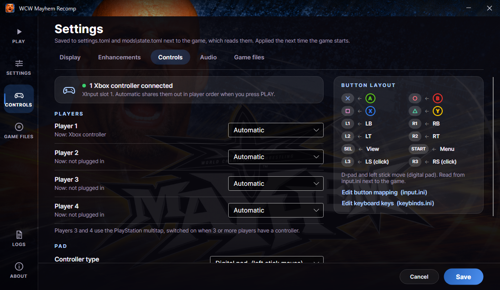

# WCW Mayhem Recomp launcher

Home screen and settings for the recompiled game in this repository (a psxrecomp static
recompilation of WCW Mayhem, PlayStation, PAL `SLES-02193`).




## Layout

- **Navigation rail** on the left: PLAY (home), SETTINGS, CONTROLS, GAME FILES, LOGS (opens the
  logs folder) and ABOUT.
- **Home**: the cover art fills the window. At the bottom is a dock with a large rounded **PLAY**
  pill, a status capsule ("Ready · 1440p · 1 Xbox controller · last played …", or what needs
  attention, with a button such as CHOOSE DISC), and small tags for what's switched on
  (Unlock all, Widescreen 16:9, Smooth motion, PGXP, CD speed 4×, Fullscreen; up to three, with
  Unlock all always first because it changes the game itself).
- **Settings** is a full page with tabs: Display, Enhancements, Controls, Audio, Game files. Each
  row has its name and a short explanation on the left and the control on the right. Cancel
  drops the edits; Save writes them, and they apply the next time the game starts.

**Play** first resolves the controllers (below), then starts
`WCWMayhem_Recompiled.exe --no-launcher --disc "<your .cue>"`, minimises, and comes back with how
the session ended: normal exit, an error line the game printed, or a crash. `--no-launcher` skips
the game's own launcher window; `--disc` outranks `settings.toml`.

### Accent colour

The accent (PLAY, Save, toggles, the selected tab and rail item, focus rings, section headers)
is defined once, in `src\WcwLauncher\Themes\AccentBlue.axaml`: the blue of the arena poster's
crowd (hue about 215°; the poster's median #153463, brightened for buttons) as `AccentColor`
#3879D6 and the `AccentStartColor` / `AccentEndColor` gradient #2561B8 → #4D90F0, with
`OnAccentColor` for text on it, and so on. `App.axaml` includes exactly one accent file, and the
Fluent theme's own accent (combo highlights, selection) is set from the same `AccentColor` at
startup. `Themes/AccentPurple.axaml` and `Themes/AccentGold.axaml` are kept as alternatives;
switching is that one `ResourceInclude` line.

## Settings and what they write

The game layers its settings as environment > command line > `settings.toml` > `game.toml` >
built-in default. The launcher shows the effective value of each one and writes a key only when
you change it, so a setting you never touched keeps following the game's `game.toml`. Every other
line of `settings.toml` (comments, keys the launcher doesn't show, other sections) is kept as it
is; a file that was valid TOML is checked again before it is written, so a save can't break it.
If `settings.toml` has a syntax error (the game then ignores the whole file and renames it
`settings.toml.bad`), the Settings page says so.

| Tab · setting | File · key | Values written |
|---|---|---|
| Display · Internal resolution | `settings.toml [video] internal_resolution` **and** `supersampling` | `"native"`, `"720p"`, `"1080p"`, `"1440p"` (recommended; also `game.toml`'s default), `"4k"`, `"5k"`, `"8k"`, `"display"`; beside it `supersampling = min(S, 4)` where S = ceil(lines / 240), as `docs\config_schema.md` describes. A custom line count already in the file is shown and kept. |
| Display · Renderer | `[video] renderer` | `"opengl"` (recommended) or `"software"`. `"vulkan"` is only listed when `game.toml` sets `[video] offer_vulkan = true` (WCW's doesn't). |
| Display · Start in fullscreen | `[video] fullscreen` | `1` (borderless) or `0`. A hand-set `2` (exclusive) is kept while the switch stays on. |
| Display · Vertical sync | `[video] vsync` | `"on"` or `"immediate"`. A hand-set `"adaptive"` is kept while the switch stays on. |
| Display · Window size | `[video] window_width` | `960` … `2560`, or the key is removed for *Automatic*. |
| Display · Texture filtering | `[video] texture_filtering` | `"nearest"` or `"bilinear"`. |
| Display · Antialiasing (smooth scaling) | `[video] antialiasing` | `true` / `false`. |
| Display · CRT colour filter | `[video] crt_filter` | `"raw"` (off), `"crt"`, `"composite"`, `"trinitron"`. |
| Display · Scanlines | `[video] scanlines`, `scanline_strength` | `true` / `false`; strength `0.3` / `0.5` / `0.8` (written only when the step is changed). |
| Enhancements · Widescreen | `mods\state.toml`, feature `wcw.enhancement.widescreen` / `widescreen` | `enabled` (manifest default **on**). |
| Enhancements · Aspect ratio | same feature, option `aspect` | `"16:9"` (validated), `"21:9"`, `"fit"`. |
| Enhancements · Smooth motion (frame blending) | feature `wcw.enhancement.smooth-motion` / `smooth-motion` | `enabled` (default off), option `rate` = `"display"` \| `"60"` \| `"120"` \| `"144"`, option `blend` = `"motion-adaptive"` \| `"linear"`. |
| Enhancements · PGXP precision | feature `psx.enhancement.pgxp` / `pgxp` | `enabled` (WCW ships its own copy of this package, `mods\preloaded`, with default **on**; the launcher reads the default from the manifest). |
| Enhancements · CD speed | feature `psx.enhancement.cd-speed` / `cd-speed` | One dropdown: *Off* writes `enabled = false` (option values left as they are); *2×* / *4×* / *8×* write `enabled = true` with `[feature.values] multiplier = "2"` / `"4"` / `"8"` and `instant = "false"` (the launcher always leaves Instant unticked). A multiplier or Instant already set by hand shows as its own entry and is kept while selected. The option `instant_budget` is never touched. |
| Enhancements · Fast boot | `settings.toml [video] fast_boot` | `true` / `false`: skips the PlayStation startup screen. |
| Enhancements · Gameplay · Unlock all | `mods\state.toml` feature `wcw.cheat.unlock-all` / `unlock-all` | `enabled = true` / `false` (default off, no options), written only when the switch changes. Greyed out when the build's `mods\bundled` has no such package. |
| Controls · Player 1–4 | `launcher.json` `Controllers`, then at PLAY `settings.toml [controller] p1_device` … `p4_device` | see Controls below. |
| Controls · (automatic) | `[controller] multitap` | written at PLAY: `true` when 3+ players have a device, else `false`. |
| Controls · Controller type | `[controller] p1_mode` … `p4_mode` | `"digital"` (Digital pad, left stick moves; WCW's `game.toml` default) or `"analog"` (DualShock, analog + vibration). Written for all four players when changed. Different per-player values in the file show as *Per player* and are left alone. |
| Controls · Stick deadzone | `[controller] p1_deadzone` … `p4_deadzone` | Low `1638` (5%), Medium `3277` (10%, the runtime default), High `6554` (20%); range 0–32767. |
| Audio · High-quality audio | `[audio] spu_hq` | `true` / `false`. |
| Audio · Output sample rate | `[audio] frequency` | `44100` (default) or `48000`. |

Mod option choices are read from the manifests the game itself loads (`mods\bundled\…`,
`mods\installed\…`), so they always match the build; a mod the build doesn't ship is greyed out.
`mods\state.toml` is written in exactly the layout of the game's own
`ModPackageManager::save_state()` (which rewrites the file that way on every start), keeping the
entries the launcher doesn't own.

**Smooth motion, honestly:** WCW Mayhem's logic and animation run at a fixed 25 fps (PAL). The
mod crossfades between those frames for display at your monitor's rate; it adds no new animation
frames, fast moves show some ghosting, and it switches the game to OpenGL with vsync off while on.
It's driven only through `mods\state.toml`: the launcher never writes `frame_interpolation` /
`frame_interpolation_fps` to `settings.toml` (the runtime ignores those for PSX titles, and two
mechanisms would conflict). The self-test checks this.

**CD speed** ("CD speed (the emulated drive; the game itself still runs at normal speed)")
divides the emulated drive's sector delay, so data arrives sooner while the game keeps its normal
speed. WCW Mayhem paces its own loading screens, so it barely shortens them; the hint says so
(a Quick Start match load measured the same at 4×). Because it changes *when* the game gets CD
interrupts, a high value can expose a timing bug, so if a load ever stalls, turn it off. FMV and
CD audio keep authentic timing.

**Unlock all** (Enhancements → Gameplay: "Unlock all: every hidden wrestler, doppelganger select
and the classic Nitro setting"; hint "Same as the PPV passwords PLYHDNGYS, DPLGNGRS and
PLYNTRCLSC, applied every session. Your memory card is not changed.") is the game's own
`wcw.cheat.unlock-all` package. Every session it switches on the game's Pay-Per-View unlock bits:
the hidden wrestlers (Eric Bischoff, Scott Hall, Ric Flair, Arn Anderson, Chris Jericho, Bam Bam
Bigelow, Mean Gene and the rest), doppelganger select and classic Nitro. Nothing is written to the
memory card, so switching it off returns the normal unlock progression. The launcher writes
nothing but its `[[feature]] package_id = "wcw.cheat.unlock-all"`, `id = "unlock-all"`,
`enabled = …` entry, in the same layout as the other features.

**Fast loading is gone.** `psx.enhancement.fast-loading` (host pacing) speeds up wall-clock time
whenever it detects a load. WCW keeps reading the CD during matches, so the game ran badly with it.
The game build now declines the package (`EXCLUDE_BUILTIN_MODS`), so it's absent from
`mods\bundled` once the game is rebuilt. The launcher no longer shows it, copes with it being
present or absent, and leaves any old `[[feature]]` entry for it in `mods\state.toml` exactly as it
is. Once the game is rebuilt without the package, the game keeps such an entry as a dormant
selection. The self-test reports where it stands.

### Settings that exist but are left out

- `[video] frame_interpolation`, `frame_interpolation_fps`: cleared at startup for PSX titles
  (`frame_interpolation_offered = false`); replaced by the smooth-motion mod.
- `[video] auto_skip_fmv` (Skip FMV): cleared at startup (`skip_fmv_offered = false`, "Skip FMVs
  is mod-owned on PSX") and WCW's catalog has no skip-FMV mod.
- `[video] aspect_ratio` (forced to 4:3; widescreen is the mod), `[video] turbo_loads`
  (deprecated), `geometry_correction` / `perspective_texturing` (covered by PGXP),
  `[controller] multitap_analog`, `p5_*`.

## Controls

The runtime reads controllers through SDL (its XInput driver sees Xbox pads) and routes each
player slot to exactly one device: a slot set to a controller ignores the keyboard, and the
other way round. The release runtime's own default is Player 1 on the keyboard, so the launcher
decides the devices itself every time PLAY is pressed:

- Each player P1–P4 has **Automatic** (default), **Xbox controller / gamepad**, **Keyboard** or
  **None**. The choices live in `launcher.json`. Keyboard is offered for every player:
  `keybinds.ini` has a `[player1]` … `[player5]` section, all on the same keys until you rebind
  them.
- At PLAY the launcher counts connected XInput controllers (`XInputGetState`, `xinput1_4.dll`,
  slots 0–3, `ERROR_SUCCESS` = connected). Automatic players share the controllers out in player
  order (after any player explicitly set to a controller): with N pads, the first N automatic
  players get `"gamepad"` and the rest `"none"`. With no pads, an automatic Player 1 gets
  `"keyboard"`. Explicit choices are written as they are. The result goes to `settings.toml
  [controller] p1_device` … `p4_device` (`"gamepad"` | `"keyboard"` | `"none"`) right before the
  game starts, and into the session log. The runtime gives each `"gamepad"` slot the first
  controller no earlier slot has claimed, so two Xbox pads become P1 and P2.
- `[controller] multitap` is written at the same time: `true` only when 3 or more players have a
  device. The PlayStation multitap is only compiled into the runtime when the game is built with
  `MAX_PLAYERS` 5 or more (`runtime\src\sio.c`: `#if PSX_MAX_PLAYERS >= 5`). A build with 4 slots
  never lets players 3 and 4 reach the game. The Controls tab warns when `build.ninja` next to the
  game exe shows fewer than 5 slots. The current build reports 5.
- The Controls tab shows the connected controllers live (checked every second, with each player's
  "Now: …" preview), and the home status line shows the count.
- **Button layout** (read from `input.ini [mapping]` next to the game; the stock map):
  A = ✕ Cross, B = ○ Circle, X = □ Square, Y = △ Triangle, LB / RB = L1 / R1, LT / RT = L2 / R2,
  View (Back) = Select, Menu (Start) = Start, stick clicks = L3 / R3, D-pad and left stick move
  (the left stick folds onto the D-pad on a digital pad). *Edit button mapping* opens `input.ini`;
  *Edit keyboard keys* opens `keybinds.ini`.

## Game disc

Choose the Redump `.cue` (its `.bin` next to it); `.bin`, `.img`, `.iso` and `.chd` also work, as
they do for the game. The launcher reads track 1 from the cue sheet and checks it against
`game.toml [prepare_disc]` (size `728503776`, MD5 `f05d7e5edad41f89e3c679dad83ea5f2`). It checks
the size first, instantly, then the MD5 in the background with progress on the status line. The
result is remembered in `dist\launcher.json` by path, size and modified time. A different image
gets a warning but can still be played. The disc is never changed. A first guess comes from the
game's own sources: `settings.toml [disc] path`, `disc.cfg`, `game.toml [game] disc`.

## Logs

The runtime writes no log file of its own. It prints to stdout/stderr and writes
`psx_last_run_report.json` into the game folder at every exit (reason `atexit` for a normal exit;
`seh`, `signal_N` or a fatal message for a crash). So the launcher captures the game's output to
`logs\last-run.log`, with the command line and the controller assignment in its header; the
previous session is kept as `previous-run.log`. It also copies a fresh exit report to
`logs\last-run-report.json`, plus any fresh `psx_freeze_dump_*.json`. A session counts as a crash
when the report's reason isn't `atexit`, or the exit code is a Windows exception.

## Art

`art\background.png` is the Mayhem arena poster (Goldberg beside the WCW/MAYHEM logo over a blue
crowd), 16:9, unblurred; the icon script reads it too. `art\*.png` / `*.jpg` is copied to
`dist\art\` at build time. The launcher also looks
for `art\` beside its exe and in `..\art`, so art dropped into the source folder shows without a
rebuild. The image fills the window: it is scaled to cover it, centred across and anchored 40%
down. At the default 1100×640 it fills by height, so the face and the logo are both whole. It
drifts very slowly. Black-to-transparent scrims sit behind the title bar, the rail and the dock,
and the Settings and About pages have their own dark backing. The cover already carries the game's
logo, so the typed "WCW MAYHEM" title only appears when there is no art (on a navy gradient with
an accent glow). An optional `art\logo.png` is shown above the dock.

The icon (exe, window, taskbar) for both the launcher and the game is drawn by
`python tools\make_icon.py`: Goldberg's face cut from the Mayhem arena poster
(`art\background.png`) on a rounded tile with a poster-blue edge. It writes
`src\WcwLauncher\Assets\` (launcher.ico, launcher-64.png, icon_master.png) and the game's
`..\assets\psxrecomp.ico` + `psxrecomp.png` (exe icon and game window icon).

## Build

```bat
build.cmd
```

Output: `dist\WCWMayhemLauncher.exe`, one self-contained file (players need no .NET install),
plus `dist\art\`. Needs the .NET 10 SDK. The launcher finds the game next to itself, or at
`build-release\WCWMayhem_Recompiled.exe` in any parent folder (the repository's `build.cmd`
output).

## Troubleshooting

`WCWMayhemLauncher.exe --self-test` writes `launcher-selftest.txt` next to the exe without opening
a window. It reports:

- the game exe and the disc check (hashing if needed);
- the effective settings and where each comes from;
- the mod catalog and the state of the mods the launcher shows (widescreen, smooth motion, PGXP,
  unlock all, CD speed), plus where Fast loading stands (still staged, absent, or excluded by the
  build; never reported as an error);
- the XInput controllers it sees, what each player's choice resolves to now (and with 0–4 pads),
  the `[controller]` keys PLAY would write, the pad type and deadzone, the build's player slots
  and the button map;
- the exact command line Play uses;
- a writer check that edits throwaway copies of `settings.toml` and `mods\state.toml` in `%TEMP%`.
  It proves every other line survives, the display, audio, controller, widescreen, smooth-motion,
  CD speed and unlock-all values read back (unlock-all's `[[feature]]` block in the game's exact
  layout), no `frame_interpolation` is written, and the result is valid TOML.
  It also simulates the next game build by saving CD speed against a copy of the catalog without
  fast-loading, and checks the old fast-loading entry is left untouched.

Add a path (`--self-test "D:\Games\WCW Mayhem (Europe).cue"`) to check that disc instead. Exit
code 0 means PASS.

`WCWMayhemLauncher.exe --capture-screenshots <folder>` opens the window without focus, saves
`screenshot-home.png`, `screenshot-settings.png` (the Enhancements tab, scrolled to its end so
CD speed, Fast boot and Gameplay · Unlock all show) and
`screenshot-controls.png` (the window's own pixels) there, and closes. Nothing is saved.
